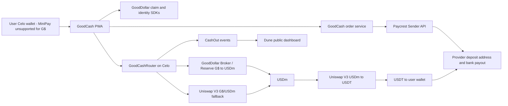

# GoodCash: Product Requirements Document

Version 0.3 | Draft | November 4, 2026 | Prepared for GoodBuilders Season 5 (kickoff November 9, 2026)

> **What changed in 0.3.** The verification spike is complete; see `docs/VERIFICATION.md` and the notes in `docs/`. Three findings changed the scope. First, **Paycrest's off-ramp API does not require customer KYC** (`source.kyc` is optional), although GoodCash still needs sender KYB and legal review. Second, **MiniPay supports only USDT/USDC/USDm**, so a G$ flow **cannot be listed as a Mini App**; the MVP ships as a mobile PWA for external wallets. Third, the Celo minimum is **$0.50 on most chains but not separately stated for Celo**, so it stays an open item. The daily claimer count at the snapshot was **~5,105**.

> **What changed in 0.2.** On-chain verification on November 4, 2026 replaced several assumptions. The most important: a typical G$ claim is about **123.5 G$ per day** (about **$0.015 gross**), the GoodDollar Reserve charges a **10% exit contribution**, and Paycrest's minimum order is **$0.50 on most chains**. A new user therefore needs roughly **five weeks of daily claims** before a first cash-out is possible. GoodCash is an **accumulate-then-cash-out** product, not a weekly cash-out product. Targets, fees, routing and MiniPay scope below reflect that. See Appendix A for the verified values.

## 1. Executive summary and problem statement

**GoodCash** is a non-custodial, mobile-first web app on Celo that lets GoodDollar (G$) holders turn G$ into a stablecoin in one guided flow, then reach naira through a licensed off-ramp partner. GoodCash never holds user funds and never pays out naira itself. It aims to keep KYC with the off-ramp partner and to minimize the data it collects; Paycrest's off-ramp API makes customer KYC optional, but GoodCash still needs sender KYB and Nigerian counsel must confirm the final posture before launch (section 12).

**Problem.** G$ is distributed daily as UBI, but holders have no simple way to spend it. Cashing out today means finding a DEX, swapping to a stablecoin, sending it to an exchange on the right network, and selling through P2P. Every step is a chance to lose money: wrong-network transfers, P2P scams, and fixed fees that swallow small balances. Many people stop at claiming.

The amounts are also much smaller than most builders assume. At the verified rate, one day's claim is about **$0.015** gross and about **$0.014** after the Reserve's 10% exit contribution. A first cash-out at the $0.50 partner minimum requires about **4,400 G$**, or roughly **36 days of daily claims**. GoodCash must therefore make accumulation legible, not pretend a user can cash out in three minutes on day one.

**Solution.** One screen shows the G$ balance, how many days until the balance clears the partner minimum, the estimated stablecoin and naira value after the GoodDollar exit contribution, swap cost and slippage, and a single confirm button. After the swap, GoodCash creates a partner order and hands the user the exact deposit address, amount and deadline.

**Why it fits GoodBuilders.** G$ moves through GoodCash's own contract, so usage is on-chain and verifiable. The product is built around claiming and converting G$, not merely accepting it as payment. The return loop is the daily claim plus a monthly cash-out ritual, which matches how the asset actually accrues.

**MVP in one line:** claim, accumulate, swap, cash out, with every cost shown up front.

## 2. Target users and personas

**Amara, 24, student in Lagos.** Claims G$ daily on an Android phone with limited data. Has never cashed out because the process looks risky, and has never held enough to make a cash-out worthwhile.

- Job to be done: turn my accumulated G$ into naira without being scammed or losing most of it to fees.

**Chidi, 32, small trader in Abuja.** Uses a mobile Celo wallet and MiniPay for stablecoins, understands stablecoins, and wants naira each month for stock and transport. May already hold G$ from selling goods or from a community payout; his G$ stays in the Celo wallet because MiniPay cannot hold it.

- Job to be done: convert on a fixed rhythm, quickly, and know the exact amount before I confirm.

**Ngozi, 38, community organizer.** Runs a WhatsApp or Telegram group of about 200 GoodDollar users and keeps answering how to cash out.

- Job to be done: give my members one safe link and one simple guide, so I stop fielding the same questions.

**Add a fourth segment: existing G$ holders with larger balances.** Traders, earners and community treasuries may hold 50,000 G$ or more. They are the users who can cash out on day one, and they are the fastest source of real volume. The product should not assume every user is a daily claimer.

## 3. Goals, non-goals, and success metrics

**Goals**

- Make the swap-and-handoff step take under 3 minutes **once the user has enough balance to cash out**.
- Show the full cost (GoodDollar exit contribution, swap fee, slippage, network fee) before the user confirms.
- Tell the user honestly how long until their balance clears the partner minimum.
- Route naira payout to licensed partners so GoodCash stays non-custodial.
- Produce verifiable on-chain and dashboard numbers for GoodBuilders reporting.

**Non-goals (MVP)**

- Custody, our own naira payouts, our own KYC program, P2P matching, a native token, fiat-to-G$ on-ramp (future phase).

**Success metrics for the season (kickoff November 9, 2026 to January 31, 2027)**

All targets are proposals to align with the GoodBuilders team. Starting values are 0 because the product is new.

| Metric | Today | Season target | Reasoning |
| --- | --- | --- | --- |
| Weekly retention | 0% | 25% | The weekly habit is claiming, not cashing out; 25% is realistic for a utility app with a monthly payout |
| Weekly active wallets | 0 | 300 | About 30 percent of 1,000 lifetime users active in a given week |
| Lifetime users (wallets) | 0 | 1,000 | Three community pilots of about 200 people, plus existing holders and organic referral |
| G$ routed through contract (cumulative) | 0 | 3,000,000 G$ | ~290 daily claimers × ~123.5 G$ × 84 days ≈ 3.0M (300 gives 3.1M); at current prices ≈ **$380–393 gross**, ≈ **$342–353 net** |
| Stretch G$ routed | 0 | 10,000,000 G$ | Requires ~1,000 users claiming daily for the whole season, or larger existing holders; keep as a stretch, not a base case |
| Users with at least one completed cash-out | 0 | 250 | First cohort clears the $0.50 minimum around mid-December; some cash out twice by January 31 |
| GoodDollar-verified users using GoodCash | 0 | 400 | Claiming requires verification, so most claimers will be verified; some will hold G$ they received |
| On-chain transactions | 0 | 3,000 | Claim, approval and swap per cash-out cycle; claims are daily |
| Median cost as % of cash-out | n/a | ≤ 13% | 10% Reserve exit contribution + ~1% swap/gas + partner fees; block above 15% |
| Median days from first claim to first cash-out | n/a | ≤ 42 | 4,400 G$ at ~123.5 G$/day is about 36 days; add buffer |
| Partners onboarded | 0 | 5 | 2 off-ramp partners plus 3 communities |
| Revenue | 0 | 0 | No GoodCash fee in MVP; fee model decided at season end |

**Price context (verified November 4, 2026):** the Mento Reserve quotes **$0.00012666 per G$** gross and **$0.00011399 net** after the 10% exit contribution. The G$/USDm Uniswap pool implies about **$0.0001131**, so the DEX has already priced in the exit fee. At the net rate, 3M G$ is about **$342**. This is pilot-scale value even though the G$ number looks large. Report both G$ and USD, or the dashboard will overstate impact.

## 4. User stories and acceptance criteria

| ID | Story | Acceptance criteria | Priority |
| --- | --- | --- | --- |
| US-1 | As a user I can connect my wallet | If `window.ethereum.isMiniPay` is true, show an unsupported-wallet notice instead of connecting, because MiniPay cannot hold G$; other Celo wallets use an injected connector or WalletConnect; wrong network shows clear instructions and never signs until resolved. Do not assume `wallet_switchEthereumChain` works in every wallet. | P0 |
| US-2 | As a user I can see my G$ balance and what it is worth | Balance and estimated stablecoin and naira value shown within 3 seconds on a slow connection; marked clearly as an estimate; net value shown after the 10% Reserve exit contribution. | P0 |
| US-3 | As a user I can swap G$ to a stablecoin | Shows minimum received before confirm; default slippage 1 percent, user cap 3 percent; swap reverts if output falls below the minimum; success screen shows amount received and the exact route used. | P0 |
| US-4 | As a user I can see all costs before confirming | Breakdown lists GoodDollar Reserve exit contribution (10% when the Reserve route is used), swap/pool fee, estimated network fee, price impact, partner fee and minimum received; warning banner when price impact exceeds 3 percent; hard block above 10 percent. | P0 |
| US-5 | As a user I can claim my daily G$ from inside the app | Eligible users see a Claim button; ineligible users see a plain-language reason and a link to GoodDollar verification; after claiming, show next claim time and the updated days-to-cash-out estimate. | P0 |
| US-6 | As a user I can continue to a licensed off-ramp partner | Partner card shows name, minimum order, what they need, estimated fee, and a button that creates an order and shows the exact deposit address, amount and deadline; GoodCash states it does not handle the naira payout. | P0 |
| US-7 | As a user I can see how long until I can cash out | Home screen shows G$ needed to reach the partner minimum, days remaining at the current claim rate, and a readiness state (Wait / Almost / Ready). | P0 |
| US-8 | As a user I can set a naira savings goal | Goal amount and progress bar based on G$ held plus cashed out; stored per wallet. | P1 |
| US-9 | As a user I can get alerts | Alert when cash-out becomes efficient (costs under a chosen percent of balance) or a goal is reached. | P1 |
| US-10 | As a user I can see my swap history | Lists past swaps from on-chain events with links to the block explorer. | P1 |
| US-11 | As a community lead I can share a referral link | Link tracks wallets that came from a community tag (wallet-level analytics only; no names or phone numbers). | P1 |
| US-12 | As a user I can use the app in Nigerian Pidgin, Hausa, Yoruba or Igbo | Language selector; core flow fully translated. | P2 |
| US-13 | As a user I can set an auto-cash-out reminder threshold | Reminder when balance exceeds chosen G$ amount. | P2 |

## 5. End-to-end user flows

**Accumulation loop (the default experience)**

1. User opens GoodCash in a mobile browser with a Celo wallet (not MiniPay, which cannot hold G$); the wallet connects through an injected connector or WalletConnect.
2. Home screen shows G$ balance, its net stablecoin value, a Claim button if eligible, and the days-to-cash-out meter.
3. User taps Claim (one transaction signed by the user; see the claim note in section 6).
4. The meter advances. If the balance is below the partner minimum, the app explains the gap and offers a reminder instead of a disabled cash-out button.
5. User returns daily or weekly. G$ accumulates.

**Cash-out path (target under 3 minutes once the balance clears the minimum)**

1. Readiness state is Ready. User taps Cash out and sees the amount, the partner minimum, and the full cost breakdown including the 10% Reserve exit contribution.
2. User chooses 25, 50, 75 or 100 percent, or a naira target; the app computes the G$ amount and the estimated naira after all fees.
3. User taps Confirm. If the G$ allowance is missing, the app requests an exact-amount approval first, then the swap.
4. The router swaps G$ to USDm through the GoodDollar Reserve (primary) or Uniswap (fallback), then USDm to USDT, and sends USDT to the user's wallet.
5. Success screen shows USDT received, the effective cost, and a Continue to naira button.
6. GoodCash's order service creates a Paycrest order and shows the provider's deposit address, the exact total to send (amount + sender fee + transaction fee) and the deadline. The user sends USDT from their own wallet; GoodCash never holds it.
7. The app polls or receives a webhook, then shows the payout status and the bank confirmation reference.
8. Return screen offers to set a savings goal or alert.

**Edge cases**

| Case | Behavior |
| --- | --- |
| Balance below partner minimum | Do not show a dead button; show G$ needed and days remaining; offer reminders and a community pooling explainer |
| Swap fails or reverts | Plain message with the reason (slippage exceeded, deadline passed, insufficient gas, Reserve paused); funds stay in the wallet; one-tap retry with a refreshed quote |
| High price impact (over 3 percent) | Warning with the cost in naira; require an explicit second tap to proceed; block above 10 percent |
| Reserve paused, at its trading limit, or circuit breaker active | Automatically quote the Uniswap fallback; label the route change and the different fee; if neither route is safe, stop and explain |
| Wrong network | Full-screen prompt with instructions; no signing prompts until resolved |
| No gas | Detect low balance before swap; explain how to get a small amount; if the wallet supports stablecoin fee abstraction, offer to pay fees in USDT/USDm (verify per wallet) |
| Unverified user | Claim hidden; show how to verify with GoodDollar; swap of existing balance still allowed |
| Already claimed today | Show next claim time; skip straight to cash out or savings |
| Quote stale (older than 30 seconds) | Auto-refresh and require re-confirmation |
| Partner down or corridor unavailable | Show status message and the second partner; never leave the user with only a dead end |
| Partner KYC or account check required | Explain what the partner needs before the user swaps, not after; never collect bank details in the swap flow |
| Order created but not funded before deadline | Show countdown and cancel/refund guidance; never imply the payout is guaranteed until the provider confirms |
| User sends the wrong amount or wrong token | Warn before sending; show exact amount and network; link to partner support |

## 6. Functional requirements

**Front end (PWA)**

- **Vite + React** (not Next.js), installable as a PWA, wagmi and viem for wallet and contract calls, Tailwind for styling.
- Initial JavaScript budget: **under 400 KB gzipped**, with route-level code splitting. A 250 KB budget is not credible with React + wagmi + viem + a UI kit; measure with Lighthouse and a real low-end Android device instead of asserting a number.
- Works on a 3G connection; system fonts; no heavy images; no animation that blocks interaction.
- Quote engine reads on-chain Reserve and Uniswap state, or a quoter contract; shows estimated naira using a labeled FX source. Prefer an on-chain quote for the swap and a partner/API quote for the naira leg, and label each separately.
- Plain-language error messages; every amount shown in G$, stablecoin and naira.
- **Privacy:** do not claim "no personal data." A wallet address is pseudonymous personal data under Nigeria's NDPA 2023, and bank details are plainly personal data. Collect the minimum, never log bank details, publish a privacy notice, define retention, and keep analytics wallet-level only.

**Claim note:** the GoodDollar claim function credits the wallet that calls it, so the GoodCash contract cannot claim on a user's behalf. Claim and cash out are therefore separate user-signed transactions presented as one guided flow. Batching with EIP-5792 is a progressive enhancement, not an assumption; MiniPay uses legacy transactions and does not support it. Verified interfaces:

- `UBISchemeV2` at `0x43d72Ff17701B2DA814620735C39C620Ce0ea4A1`: `checkEntitlement()`, `checkEntitlement(address)`, `claim()`, `hasClaimed(address)`, `lastClaimed(address)`, `currentDay()`, `getDailyStats()`, `getClaimAmount(uint256)`.
- `IdentityV4` at `0xC361A6E67822a0EDc17D899227dd9FC50BD62F42` for verification status.
- Use `@goodsdks/citizen-sdk` (`ClaimSDK`: `checkEntitlement`, `claim`, `nextClaimTime`, `getDailyStats`) and `@goodsdks/identity-sdk` rather than hand-rolling the interfaces.

**Backend (required for off-ramp, optional for swap)**

- A small serverless service (Cloudflare Workers or similar) that proxies the Paycrest Sender API. The API key must never ship in the client.
- The service creates orders, returns the provider deposit address and exact total, and receives webhooks. It stores wallet address, order id, status and timestamps; it must not store bank account details beyond what the partner requires for the order.
- Optional: FX rate caching and alert delivery (Telegram bot or web push).
- The core swap flow must work with no backend, so an outage never blocks a self-custodial swap. The off-ramp handoff does require the backend.

**Smart contract:** see section 7.

## 7. Smart contract specification

**Contract:** `GoodCashRouter`, a thin, immutable wrapper that pulls G$ from the user, swaps through allowlisted venues, and sends the output straight to the recipient. It holds tokens only transiently inside a transaction; it is not a vault and must end every call with a zero balance of user tokens.

**Core function**

```solidity
enum Route {
    RESERVE_TO_USDM,          // G$ -> USDm via GoodDollar/Mento Broker
    UNISWAP_TO_USDM,          // G$ -> USDm via Uniswap V3
    RESERVE_THEN_UNISWAP,     // G$ -> USDm via Broker, USDm -> USDT via Uniswap V3
    UNISWAP_THEN_UNISWAP      // G$ -> USDm via Uniswap V3, USDm -> USDT via Uniswap V3
}

function cashOut(
    Route route,
    uint256 amountIn,
    uint256 minAmountOut,
    uint256 deadline,
    address recipient,
    bytes32 ref
) external returns (uint256 amountOut);
```

Use an enum plus immutable, allowlisted venue addresses. **Do not** accept an arbitrary `bytes path`, arbitrary router address or arbitrary calldata; that turns the contract into a confused-deputy risk. If a new venue is needed, deploy a new router.

**Verified addresses and route facts (Celo mainnet, chainId 42220)**

| Item | Value |
| --- | --- |
| G$ | `0x62B8B11039FcfE5aB0C56E502b1C372A3d2a9c7A` (18 decimals) |
| USDm (cUSD) | `0x765DE816845861e75A25fCA122bb6898B8B1282a` (18 decimals) |
| USDT | `0x48065fbBE25f71C9282ddf5e1cD6D6A887483D5e` (6 decimals) |
| USDC | `0xcebA9300f2b948710d2653dD7B07f33A8B32118C` (6 decimals) |
| NGNm | `0xE2702Bd97ee33c88c8f6f92DA3B733608aa76F71` (18 decimals) |
| GoodDollar Broker (proxy) | `0x88de45906D4F5a57315c133620cfa484cB297541` (implementation `Broker`) |
| GoodDollar Exchange Provider | `0x2fFBB49055d487DdBBb0C052Cd7c2a02A7971e41` |
| G$/USDm exchangeId | `0xba77f5c7bb3317643c6d81d1ef3f9913561741d92095f88efa402faf2cbe9124` |
| GoodDollar Reserve (proxy) | `0x94A3240f484A04F5e3d524f528d02694c109463b` (implementation `Reserve`) |
| G$/USDm Uniswap V3 pool | `0x9491d57c5687AB75726423B55AC2d87D1cDa2c3F`, fee tier 1% |
| UBISchemeV2 | `0x43d72Ff17701B2DA814620735C39C620Ce0ea4A1` |
| IdentityV4 | `0xC361A6E67822a0EDc17D899227dd9FC50BD62F42` |

The Broker address discrepancy is resolved: `0x88de...` is the Broker proxy (implementation named `Broker`); `0x94A3...` is the Reserve proxy (implementation named `Reserve`). The Broker signature is verified from the implementation source:

```solidity
function swapIn(
    address exchangeProvider,
    bytes32 exchangeId,
    address tokenIn,
    address tokenOut,
    uint256 amountIn,
    uint256 amountOutMin
) external returns (uint256 amountOut);
```

The Broker pulls `tokenIn` from `msg.sender`, so the router approves the Broker and receives `tokenOut`; it then forwards the output to the user.

**Behavior**

1. Require `deadline >= block.timestamp`, `amountIn > 0`, `minAmountOut > 0`, `recipient != address(0)`, and a valid `route` enum.
2. Pull G$ from `msg.sender` with `SafeERC20.safeTransferFrom`.
3. Approve the first venue for exactly `amountIn`, execute the first hop, and reset the approval to 0.
4. For routes that end in USDT, approve the second venue for the exact USDm amount, execute the second hop, and reset the approval to 0.
5. Require the final output at or above `minAmountOut`, measured by the recipient's balance delta (fee-on-transfer-safe, and mandatory because some tokens are not plain ERC-20s).
6. Send the output to `recipient`.
7. Emit `CashOut(address indexed user, address indexed recipient, address tokenOut, uint256 amountIn, uint256 amountOut, uint8 route, bytes32 ref)`.

**Reserve route semantics (verified)**

- `getAmountOut(exchangeId, G$, USDm, 1000e18)` returns **0.113992939 USDm**, i.e. **$0.00011399/G$**, exactly the gross price minus the 10% exit contribution.
- The exchange's `exitContribution` is **10,000,000 / 1e8 = 10%**. The Reserve's `reserveRatio` is about **39.97%**, reserve balance about **259,722 USDm**, token supply about **5.13B G$**.
- Entry (USDm → G$) has no exit fee: `1 USDm` quotes about **7,895 G$**.
- Do not describe the 10% as a GoodCash fee. It is the protocol's exit contribution and must be labeled as such.
- Check Mento's trading limits and pause state in the quote path. If the Reserve is paused or at its limit, fall back to Uniswap and say so.

**Uniswap fallback facts (verified)**

- The G$/USDm 1% pool holds about **8.37M G$** and **498 USDm**, roughly **$1,450 TVL**. It is thin: a $100 swap can move the price materially.
- Implied pool price is about **$0.0001131/G$**, essentially the same as the Reserve net price, so the fallback is not a way to avoid the 10% economics; it is a liveness fallback.
- Do not hardcode the USDm/USDT pool. Resolve it at build time through the Uniswap factory and quote both venues; if liquidity is below roughly 10× the swap size, refuse or route to the Reserve.

**Parameters and decisions**

- **Slippage and deadline:** computed client-side; default 1 percent, maximum 3 percent (not 5; thin liquidity makes 5 percent dangerous); default deadline 10 minutes from signing.
- **Fee:** none in MVP. Reserve a `feeBps` variable fixed at 0 and cap any future value at 100 (1%) in code. A GoodCash fee is a season-end decision, not an MVP feature.
- **Access control:** a Safe multisig owns the contract. Owner can pause, unpause, and add or remove allowlisted output tokens and venues. Owner cannot move user funds.
- **Upgradeability:** none. Immutable contract; a new version means a new deployment. This is simpler and easier for users and GoodBuilders reviewers to trust.
- **Stray funds:** a rescue function for tokens sent to the contract by mistake. It must not be able to touch tokens in flight; use balance deltas and a pause in an emergency.
- **Token behavior to verify before deploy:** G$ decimals (18 confirmed), transfer hooks or fees, and whether it is a plain ERC-20. Assert the balance delta, not the nominal amount.

**Security considerations**

- `ReentrancyGuard` on `cashOut`; checks-effects-interactions ordering; no delegatecall; no arbitrary external calls.
- **MEV and sandwiches:** thin G$ liquidity makes manipulation realistic. The enforced minimum output is the main defense; keep trade sizes bounded with price impact warnings and a hard block at 10 percent. Do not assume Celo's block production removes the risk.
- **Oracle and circuit-breaker risk:** Mento pools can pause or hit trading limits, and FX-priced pools can be gated. The fallback route must be tested, not theoretical.
- **Protocol risk:** the September 4, 2026 Superfluid exploit drained about $86K from the GoodDollar Celo reserve and about $19K from DEX pools; reserves reopened September 29–30, 2026, and one Uniswap V4 pool was still blocked. This is a real liveness risk. Link the post-mortem in the app's risk disclosure and test the pause/fallback path.
- **Testing:** fork tests against the real Reserve and pool, fuzz tests for amounts and routes, an invariant test that the contract balance is 0 after every call, and a Slither pass. Seek an independent review before any real volume if timing allows.
- **Do not route claims through the router.** The claim credits `msg.sender`; keep it a separate user transaction.

## 8. UX requirements

**Low-end Android and low bandwidth**

- Design for 360 px width, tap targets at least 48 px, system fonts, no animations that block interaction.
- Skeleton states and a cached last-known balance so the screen stays useful when the RPC is slow.
- Never show a broken state; show last known data with a clear stale label.

**Copy and tone**

- Plain, friendly, short sentences. Say 'Cash out your G$' not 'Execute swap'.
- Always four numbers together: you give, you get (at least), what it costs, and why (exit contribution, swap fee, network fee).
- Use the word estimate for any naira figure and say what it is based on.
- Never use jargon like slippage without a one-line explanation; label it 'Price protection'.
- Say 'GoodDollar Reserve exit contribution (10%)' rather than hiding it inside a single fee number.
- On the home screen, say 'About 36 days of daily claims until you can cash out $0.50' rather than showing a disabled button.

**Trust and safety UX**

- Show the contract address and a link to the verified source on the explorer.
- A fixed banner: GoodCash will never ask for your seed phrase or send you direct messages first.
- Before the partner handoff, a short checklist: correct network, correct address, exact amount, never share your phrase.
- **MiniPay:** if `window.ethereum.isMiniPay` is true, show the unsupported-wallet notice and do not connect, claim or swap, because MiniPay cannot hold G$. Never display, copy or ask users to share their wallet address, and do not use `personal_sign` or `eth_signTypedData`. Test on a physical device.

## 9. Retention and reason to return

Rewards are not the reason to come back. The reason is that G$ builds up every day and the best time to cash out changes.

- **Cash-out readiness meter:** a simple indicator on the home screen that compares total fees and price impact with the balance. It says Wait, Almost, or Ready. Because the 10% exit contribution and the $0.50 minimum hurt small balances, this teaches accumulation instead of tiny, costly swaps.
- **Daily claim streak:** a non-monetary streak for consecutive claim days, with a weekly summary. This is the real habit loop.
- **Weekly cash-out day (revised):** users pick a day; GoodCash reminds them to claim and check readiness. Cash-out itself happens when the balance clears the minimum, typically every 5–10 weeks for a new daily claimer.
- **Naira savings goal (P1):** users set a target such as a school fee or rent, and see progress as they claim and cash out.
- **Rate alerts (P1):** a Telegram or web push message when the estimated naira rate or the cost percentage crosses the user's threshold.
- **Community kits (P1):** a shareable guide and link for community leads like Ngozi, so groups claim together and batch their cash-outs on a set day. Pooling real funds requires explicit trust and custody safeguards; do not ship a pooled wallet without legal review. A "claim together, cash out individually" kit is the safe MVP.

## 10. How G$ is used inside the product

The aim is for G$ to do real work inside GoodCash, not just be accepted as payment.

- **Claim integration:** the app drives the daily G$ claim and reads GoodDollar verification status.
- **G$ as the input to every cash-out:** all swapped G$ passes through the GoodCash contract, so G$ used is directly measurable from `CashOut` events.
- **First cash-out fee rebate (P1, subject to funding):** use a share of GoodBuilders streams to reimburse a new user's first swap costs in G$, which circulates G$ and removes the biggest barrier to trying the product.
- **New ideas for this season (P2):** round-up savings pledges (a chosen percent of each claim set aside for a goal), community claim days, and G$ streaming to a savings goal. Do not promise pooled custody.

## 11. Analytics and dashboard specification

**Principles:** wallet addresses are pseudonymous personal data, not "no personal data." On-chain events are the source of truth for volume and users; off-chain events cover funnel steps only. Never send bank details, names, phone numbers or raw partner payloads to analytics.

**Events**

| Event | Source | Properties |
| --- | --- | --- |
| wallet\_connected | app | wallet, wallet type (MiniPay or other), referral tag |
| balance\_viewed | app | G$ balance bucket |
| readiness\_viewed | app | balance bucket, days-to-minimum bucket, state |
| quote\_shown | app | amount, route, price impact, exit contribution, swap fee, estimated naira |
| swap\_submitted | app | amount, slippage setting, route |
| CashOut | contract | user, recipient, tokenOut, amountIn, amountOut, route, ref |
| swap\_failed | app | reason code (slippage, reserve paused, limit, gas, RPC) |
| claim\_confirmed | on-chain | wallet, amount |
| handoff\_clicked | app | partner |
| order\_created / order\_paid / order\_settled | app/backend | partner, amount bucket, status (no bank details) |
| goal\_created / alert\_created | app | goal bucket, alert type |
| weekly\_return | derived | wallet active in two consecutive weeks |

**Dashboard (Dune, public):** cumulative and weekly G$ routed, **USD value at the time of each swap**, number of swaps, unique wallets, new vs returning wallets, weekly retention, median swap size, median cost percent, route split (Reserve vs Uniswap), cash-out completion rate, partner handoff clicks.

**Mapping to GoodBuilders application fields**

| Application field | GoodCash source |
| --- | --- |
| 2.2 Lifetime users | Distinct wallets with any app event or CashOut |
| 2.3 Active users | Distinct wallets with a CashOut or claim in the last 30 days |
| 2.4 Active users frequency | Daily for claims, monthly for cash-outs |
| 2.5 GoodDollar-verified users | Active wallets that are whitelisted in GoodDollar identity |
| 2.6 On-chain transactions | Count of claims, approvals and swaps from GoodCash |
| 2.7 Revenue | 0 in MVP |
| 2.8 Tracking link | Public Dune dashboard |
| 5.3 Weekly retention | Share of last week's active wallets active this week |
| 5.6 Users earning G$ | Wallets that claimed through GoodCash |
| 5.7 G$ used inside product | Sum of amountIn from CashOut events |
| 6.7 to 6.9 Targets | Section 3 targets, adjusted with the GoodBuilders team |

## 12. Compliance and risk

**Regulatory posture:** GoodCash is a non-custodial interface plus a swap router. It does not hold funds or run naira payouts. However, **it is not accurate to say it does no KYC at all**. To use the Paycrest Sender API, GoodCash must be a **KYB-verified sender**. Paycrest's docs state that senders own their local regulatory obligations, while the off-ramp API makes `source.kyc` **optional** (on-ramp requires it). So the API does not force customer KYC on every off-ramp, but local law may. Whether GoodCash must KYC users is a legal question, not a product assumption. Get a Nigerian fintech/securities lawyer to confirm the posture before launch, and design the flow so the partner owns as much of the customer check as possible.

**Privacy:** wallet addresses and bank details are personal data under the NDPA 2023. Publish a privacy notice, define lawful basis and retention, minimize collection, never log bank details, and run a DPIA before launch. Do not repeat the v0.1 claim that analytics contain "no personal data."

| Risk | Impact | Mitigation |
| --- | --- | --- |
| G$ UBI is too small to cash out | Users cannot reach the partner minimum; retention collapses | Readiness meter, days-to-minimum, reminders, monthly (not weekly) cash-out framing, target existing holders with larger balances |
| 10% Reserve exit contribution | Users lose a tenth of value; product feels expensive | Show it explicitly, compare against the DEX route, set a cost-percent cap, explain the protocol reason |
| Thin G$ liquidity and high slippage | Users lose value; product feels broken | Price impact warnings, hard block at 10 percent, readiness meter, test real swap sizes before launch |
| Reserve paused or at trading limit | Cash-out blocked | Uniswap fallback, status messaging, retry path |
| September 2026 exploit recurrence | Reserve or pool liquidity unavailable; users scared | Publish the post-mortem link, test pause/fallback, never imply protocol deposits are risk-free |
| Sandwich or price manipulation | Users receive less than expected | Enforced minimum output, tight default slippage, bounded trade sizes |
| Partner dependency or downtime | Users cannot finish the cash-out | At least two partners, status messages, clear fallback to manual instructions |
| Partner KYC / KYB obligation | GoodCash may need to collect customer data or register | Legal review before launch; choose partner and flow that minimize GoodCash's role; do not promise "no KYC" in marketing |
| Phishing and fake GoodCash sites | Users lose funds | Verified contract link, fixed safety banner, single official domain, community education |
| Wrong-network transfers | Funds sent to wrong chain | Network checks, pre-filled partner links, final checklist before handoff |
| Smart contract bug | Loss of user funds | Minimal contract, no custody, fork and fuzz tests, independent review, pause switch |
| Regulatory change | Partners or banks restrict service | Stay non-custodial, monitor SEC and CBN updates, legal review |
| FX rate inaccuracy | Users misled about naira value | Label as estimate, show source, prefer partner-provided quotes |
| MiniPay is not a distribution channel for G$ | No Mini App listing; smaller reach | Ship a mobile PWA for external wallets; do not apply for MiniPay listing in Season 5; if MiniPay reach is mandatory, scope a separate USDT-only product and confirm the provider-withdrawal rule first |
| Low demand because amounts are small | Targets missed | Pool claim days, readiness meter, review volume targets with GoodBuilders, recruit existing holders |

## 13. Technical architecture and stack



**Recommended stack**

- Front end: **Vite + React PWA**, TypeScript, wagmi and viem, Tailwind.
- Contracts: Solidity with Foundry, OpenZeppelin libraries, Slither, deployed from a Safe multisig.
- Off-ramp service: Cloudflare Workers (or similar) for Paycrest order creation, webhooks, FX cache and alerts. A small database only for orders, goals and alert preferences.
- Analytics: Dune dashboard on contract events; lightweight privacy-friendly funnel events.
- Hosting: static hosting with a CDN; a single official domain.

**Network and token matrix**

| Asset | Chain | Address | Decimals | Role |
| --- | --- | --- | --- | --- |
| G$ | Celo | `0x62B8...9c7A` | 18 | Input |
| USDm | Celo | `0x765D...282a` | 18 | Intermediate |
| USDT | Celo | `0x4806...3D5e` | 6 | Off-ramp input |
| USDC | Celo | `0xcebA...118C` | 6 | Alternate off-ramp input |
| NGNm | Celo | `0xE270...6F71` | 18 | Future direct-NGN research only |
| cNGN | Celo | `0xF682...1a4f` | 6 | Paycrest payout token; no G$→cNGN route assumed |

**MiniPay scope decision (make this explicit):** G$ is not a MiniPay-native asset, and MiniPay supports only **USDT, USDC and USDm**; it forbids arbitrary ERC-20s in a Mini App. A G$ flow therefore **cannot be listed as a Mini App**, and the MiniPay wallet cannot hold G$. The MVP ships as a **mobile PWA for external Celo wallets**, not as a Mini App. Do not put "MiniPay Mini App" in the GoodBuilders application. If MiniPay reach becomes mandatory, scope a separate USDT-only product and confirm with MiniPay that sending to a provider deposit address is allowed.

## 14. Build plan and season roadmap

**5-day MVP build (November 4 to 8, 2026)**

| Day | Deliverables |
| --- | --- |
| Wed Nov 4 | Verification spike: confirm addresses, Reserve quote and 10% exit contribution, UBI claim interface, Paycrest Celo corridor and minimum; scaffold the repo |
| Thu Nov 5 | Write `GoodCashRouter` (Reserve route first, Uniswap fallback second), fork and fuzz tests, deploy to Celo testnet (Alfajores/Sepolia as available) |
| Fri Nov 6 | Deploy to Celo mainnet behind a pause, verify source, run a small real swap; front end: connect, balance, quote, readiness meter |
| Sat Nov 7 | Swap flow, claim step, cost breakdown, partner handoff, error states |
| Sun Nov 8 | Dune dashboard, public repo and README, safety banner, Submit the application; apply earlier if the contract and repo are ready |

**Mainnet gate:** deploy only if the fork tests pass, the Reserve quote matches the expected 10% net, a small real swap succeeds, and the owner is a Safe. Mainnet deployment on day 3 of a 5-day build is aggressive; a testnet-only demo with a verified mainnet deployment is acceptable if the gate is not met.

**12-week season roadmap (kickoff November 9, 2026)**

| Milestone date | Deliverable | Wallets (cumulative) | Weekly actives | G$ routed (cumulative) | Weekly retention | Partners |
| --- | --- | --- | --- | --- | --- | --- |
| Nov 22 | Public mainnet launch, dashboard live, first partner handoff, first community pilot | 100 | 40 | 0.15M | baseline | 1 |
| Dec 6 | Readiness meter, savings goals, rate alerts v1, contract review | 250 | 90 | 0.45M | 18% | 2 |
| Dec 20 | Second partner, first cash-out fee rebate pilot, community kits | 450 | 150 | 0.95M | 20% | 3 |
| Jan 3 | Pidgin and Hausa UI, referral links, low-end performance pass | 650 | 200 | 1.55M | 22% | 3 |
| Jan 17 | Reminder thresholds, second stablecoin option, research on a second country | 850 | 250 | 2.3M | 24% | 4 |
| Jan 31 | Season report, docs, sustainability plan, fee model decision | 1,000 | 300 | 3.0M | 25% | 5 |

The G$ curve assumes daily claiming at ~123.5 G$/user/day, not weekly cash-outs. Report the USD equivalent alongside it; 3M G$ is about $340 net at current prices.

## 15. Open questions and assumptions to verify

**Resolved on November 4, 2026 (see Appendix A):**

1. G$ address, decimals and price on Celo.
2. GoodDollar Broker, Exchange Provider, exchangeId and Reserve addresses.
3. The 10% exit contribution and the net G$→USDm rate.
4. The G$/USDm Uniswap pool address, fee tier and depth.
5. UBISchemeV2 and IdentityV4 addresses and claim interface.
6. Paycrest supports Celo, USDT/USDC/cNGN and NGN; minimum order is $0.50 on most chains; mainnet only; sender must be KYB-verified; off-ramp `source.kyc` is optional in the API.
7. Current UBI: ~123.5 G$ per eligible user per day, with about 5,100 claimers on day 1344 at verification time (the count rises during the day).
8. MiniPay supports only USDT/USDC/USDm, so a G$ flow cannot be a listed Mini App.

**Still open:**

1. The exact production minimum and per-corridor limits for Paycrest on Celo (the $0.50 figure is documented for most chains; a "minimum of 1" error exists for some networks; Celo is not separately stated).
2. Whether Nigerian law requires GoodCash to KYC end users even though Paycrest's off-ramp API makes `source.kyc` optional.
3. Whether any path could make a G$-input app listable in MiniPay; assume no for Season 5.
4. The best naira FX source: partner quote, public feed, or both; how to label and timestamp it.
5. Whether an independent contract review is affordable before launch.
6. Whether common Celo wallets support EIP-5792 batching for claim + approve + swap (assume no for MVP).
7. Whether GoodDollar permits the GoodCash name, logo treatment and contract naming without implying an official product.
8. The current GoodBuilders rules, eligibility details and reporting requirements (confirm at ubi.gd/goodbuilders).
9. Whether a direct G$→NGNm or G$→cNGN route is liquid enough to skip the USDm/USDT leg (NGNm exists; do not assume liquidity).
10. The legal treatment of the 10% exit contribution in user-facing pricing (is it a "fee" that must be disclosed in a specific way?).

## 16. How this maps to the GoodBuilders application

**Primary build goal (1 sentence):** Make G$ spendable by giving GoodDollar users a safe, low-cost way to claim, accumulate and cash out to naira, without GoodCash ever holding their funds.

**G$ integration description:** GoodCash drives the daily G$ claim and routes every cash-out through its own open-source Celo contract, so each swap is G$ used inside the product and is verifiable on-chain. It turns G$ from a token people hold into one they can actually use.

**Ecosystem impact (1 to 2 sentences):** GoodCash removes the biggest barrier between G$ holders and real-world value, which should increase daily claiming, G$ circulation and trust in GoodDollar as income. Its public dashboard and community kits also give other builders a template for responsible, non-custodial off-ramping.

**Reason to return:** G$ accumulates daily and the best moment to cash out changes with fees, liquidity and the partner minimum, so users come back to claim, check the readiness meter, and move toward their naira savings goal.

### Top 10 risks to resolve before coding

1. Confirm the user can actually reach the partner minimum in a reasonable time at the current UBI rate.
2. Confirm the Reserve route, the 10% exit contribution and the Uniswap fallback with real quotes.
3. Confirm the claim interface and eligibility checks through the GoodDollar SDK.
4. Confirm at least one licensed off-ramp partner supports Nigeria, Celo USDT and the $0.50 minimum, and agrees to be linked.
5. Confirm with counsel whether GoodCash must KYC users even though Paycrest's off-ramp API makes `source.kyc` optional.
6. Confirm the naira FX estimate source and how it is labeled.
7. Confirm the regulatory posture with a Nigerian lawyer.
8. Decide how the contract will be reviewed before real volume.
9. Ship as a mobile PWA; do not apply for MiniPay listing in Season 5 (G$ is not a supported MiniPay asset).
10. Confirm GoodBuilders eligibility, rules and what counts as a meaningful integration.

## Appendix A: Verified on-chain facts (Celo mainnet, November 4, 2026)

**G$ / Mento Reserve**

- `currentPrice(exchangeId)` = `126658838063094` → **$0.000126659/G$** gross.
- `getAmountOut(exchangeId, G$, USDm, 1000e18)` = `113992939240294538` → **0.113992939 USDm** for 1,000 G$, i.e. **$0.000113993/G$ net**.
- `getAmountOut(exchangeId, USDm, G$, 1e18)` = `7895215680813390442966` → **7,895.22 G$ per USDm**.
- Exchange tuple: reserve asset **USDm**, token **G$**, token supply **5,129,947,074.39 G$**, reserve balance **259,721.90 USDm**, reserve ratio **39,972,397 / 1e8 ≈ 39.97%**, exit contribution **10,000,000 / 1e8 = 10%**.
- Broker proxy `0x88de45906D4F5a57315c133620cfa484cB297541`; Exchange Provider `0x2fFBB49055d487DdBBb0C052Cd7c2a02A7971e41`; exchangeId `0xba77f5c7bb3317643c6d81d1ef3f9913561741d92095f88efa402faf2cbe9124`.

**UBI**

- `currentDay()` = **1344**; `dailyUbi()` = **123.487460818950479993 G$** per eligible user.
- `getDailyStats()` snapshot = **5,105 claimers**, **630,403.487481189217387277 G$** claimed on day 1344 at verification time (5,105 × 123.49 ≈ 630,404 G$, cross-check confirmed; the count rises during the day, so earlier reads showed 5,065).
- At the net rate, one day's claim ≈ **$0.01408**; one week ≈ **$0.0985**; 30 days ≈ **$0.422**.
- To reach **$0.50** net: ~**4,386 G$** ≈ **36 days**. To reach **$1.00** net: ~**8,772 G$** ≈ **71 days**.

**Uniswap G$/USDm pool**

- Pool `0x9491d57c5687AB75726423B55AC2d87D1cDa2c3F`, fee **1%**, token0 G$, token1 USDm.
- Balances: **8,374,336.09 G$** and **498.1997 USDm** (~**$1,450 TVL**).
- Implied price from `slot0` ≈ **$0.0001131/G$**; `liquidity` = `513126848494862479630762`.

**Paycrest (from docs, November 4, 2026)**

- Celo is supported for USDT, USDC and cNGN; NGN is a supported payout currency. Celo cNGN is `0xF6829D7393dAe24509eb1E52eE8e572e2E271a4f` (6 decimals).
- Minimum order: **$0.50 on most chains**; some networks enforce a minimum of **1 unit** of the stablecoin; Celo is not separately stated, so confirm with support.
- Mainnet only; there is no sandbox. Start with small real orders.
- Sender must be **KYB-verified**; senders own their local regulatory obligations. Off-ramp `source.kyc` is **optional** in the API (on-ramp requires it); this does not remove the need for legal review.
- Off-ramp flow: `POST /v2/sender/orders` → `providerAccount.receiveAddress` + exact total (`amount + senderFee + transactionFee`) + `validUntil`; the user's wallet sends the exact total on the specified network.

**MiniPay (from Celopedia, November 4, 2026)**

- No Connect Wallet button; auto-connect when `window.ethereum.isMiniPay` is true.
- `personal_sign` and `eth_signTypedData` are unavailable; use legacy transactions; no EIP-1559.
- Never display, copy or share the user's wallet address.
- USDT support is mandatory; only USDT, USDC and USDm are native. Arbitrary ERC-20s such as G$ are not permitted in a Mini App, so this flow cannot be listed.
- Gas can be paid in stablecoins via `feeCurrency`; MiniPay may override the field. Use adapter addresses for USDT/USDC, not the token address.
- 2 MB bundle limit; test on a physical device.

**GoodDollar incident**

- September 4, 2026: ~$86K from the GoodDollar Celo reserve, ~$19K from DEX pools and ~$20K from the XDC reserve; root cause was the Superfluid Celo deployment, not GoodDollar contracts. Reserves reopened September 29–30, 2026; one Uniswap V4 pool remained blocked.
- Post-mortem: `https://discourse.gooddollar.org/t/gooddollar-incident-post-mortem-september-4-attack/9164`.

## Appendix B: Quote and route-selection rules

1. Fetch the Reserve quote with `getAmountOut(exchangeId, G$, USDm, amountIn)` and the Uniswap quote for the same size.
2. Convert both to final USDT through the same second hop so the comparison is apples-to-apples.
3. Subtract estimated network fees (in USD) and the partner fee to get net naira.
4. Prefer the Reserve when quotes are within 1% of each other, because it is deeper and less manipulation-prone.
5. Use Uniswap only when the Reserve is paused, at its trading limit, or quoting more than 1% worse after fees.
6. Refuse the trade when the best route's price impact exceeds 10%, or when pool depth is less than 10× the swap size.
7. Re-quote every 30 seconds; never sign a quote older than 30 seconds.
8. Show the route name in the confirmation and in the success screen, so support can debug what happened.
